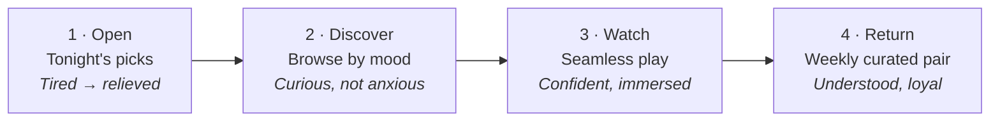

# Future State Journey: Curated Streaming

> **Strategy:** Restore brand authority and win back users by prioritizing human-led curation over mass-market scale.

| | |
|---|---|
| **Persona** | Young professional in her late 20s who pays for her own subscription and watches casually on weeknights. |
| **Goal** | Land on something she'll enjoy within a few minutes, so every subscription dollar feels worth it. |
| **Value prop** | Curated streaming delivers a more personalized experience that wins her preference regularly, which reduces churn and builds loyalty. |

## Journey at a glance

## The 4 stages

| Stage | User action → benefit | Internal state | Pain point addressed | Evidence |
|---|---|---|---|---|
| **1. Open:** *Tonight's picks* | Opens to three curator picks for tonight → decides in minutes. | Tired → relieved | 20-minute scroll; full-volume autoplay trailers | UXR-01, UXR-05, BUG-1077 |
| **2. Discover:** *Browse by mood* | Browses curator shelves like "Quiet Sunday" → finds fresh titles that fit her mood. | Curious, not anxious | Repetitive recommendations; no mood browsing; search only works with exact titles | UXR-07, UXR-09, BUG-1080, BUG-1091 |
| **3. Watch:** *Seamless play* | Hits play; list and progress sync across devices → she finishes what she starts. | Confident, immersed | Buffering that kicks her to the home screen; lost watchlist; restarts at 0:00 | UXR-06, UXR-08, UXR-11, BUG-1042, BUG-1058, BUG-1061 |
| **4. Return:** *Weekly curated pair* | Gets two hand-picked films weekly and shares favorites → the subscription feels worth it. | Understood, loyal | "Warehouse" feeling; trusting friends over the algorithm | UXR-04, UXR-10, UXR-12 |

## Competitive advantages over the manual workaround

1. **Faster decisions:** One confident pick replaces texting friends, endless scrolling and YouTube fallbacks.
2. **Trusted curation:** Human curators bring the "friend recommendation" inside the app, where it builds loyalty.
3. **Continuity:** Picks, watchlist and progress follow her across devices, so she never loses her place.

---

*Sources: user research notes UXR-01 to UXR-12 and bug reports BUG-1042 to BUG-1121.*
